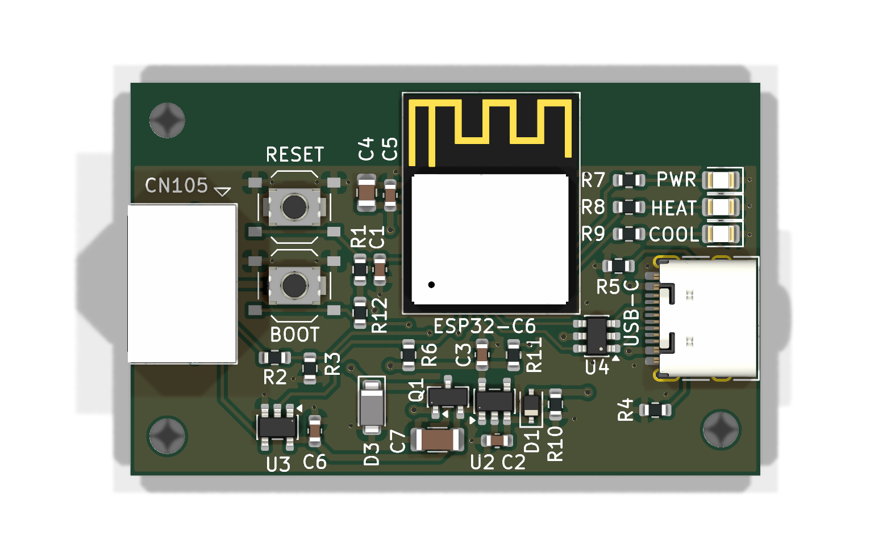

# esp105 — ESP32-C6 adapter for Mitsubishi CN105

A small board that plugs into the CN105 port of a Mitsubishi mini-split, is powered by it, and
talks to it over its serial port with an ESP32-C6 (Wi-Fi or Thread).

| Folder | Contents |
|---|---|
| [`hardware/`](hardware/) | KiCad 10 project: schematic, routed 2-layer PCB, project libraries, BOM with verified LCSC numbers, and the guide for working on it. Start with [hardware/README.md](hardware/README.md). |
| [`software/`](software/) | Firmware (ESPHome configuration) — to come. |

Open the board in KiCad via `hardware/cn105.kicad_pro`.

## License

Copyright 2026 Jeff Hamilton.

This source describes Open Hardware and is licensed under the
[CERN Open Hardware Licence Version 2 - Permissive](https://ohwr.org/cern_ohl_p_v2.txt)
(SPDX: `CERN-OHL-P-2.0`). You may redistribute and modify this documentation and make products
using it under the terms of that licence. It is distributed WITHOUT ANY EXPRESS OR IMPLIED
WARRANTY, INCLUDING OF MERCHANTABILITY, SATISFACTORY QUALITY AND FITNESS FOR A PARTICULAR PURPOSE.
See [LICENSE](LICENSE) for the full text and conditions.
