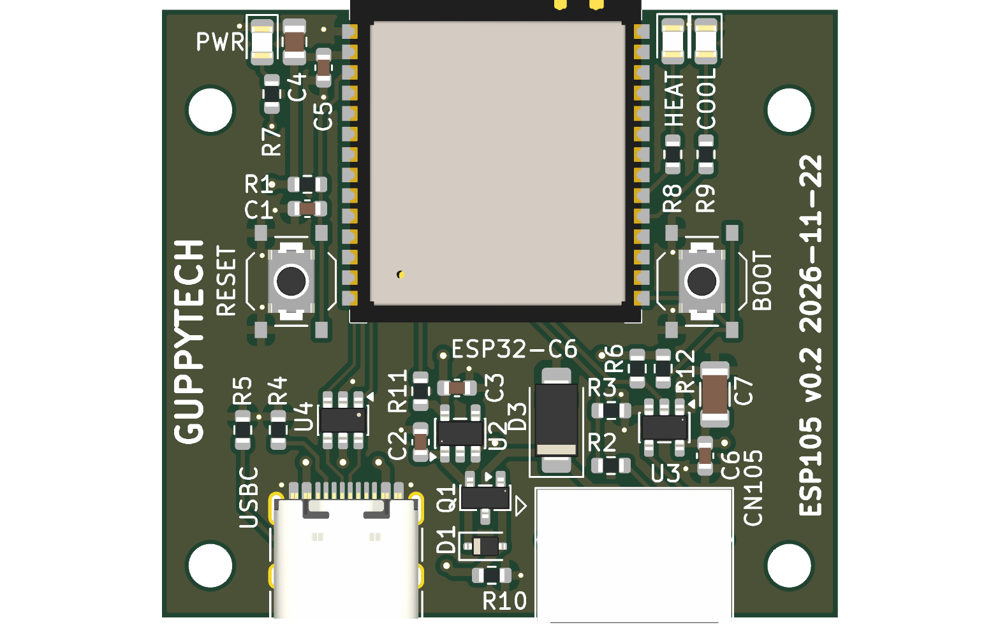

# CN105 ↔ ESP32-C6 adapter — KiCad starter project

A small board that plugs into the CN105 port of a Mitsubishi mini-split, is powered by it, and talks
to it over its 5 V serial port using an ESP32-C6 module (Wi-Fi or Thread, chosen in firmware).

**Status: rev B in progress.** The v0.1 boards (tag `v0.1`) used the ESP32-C6-MINI-1-H8, which
JLCPCB only assembles under its Standard service. The schematic now carries the ESP32-C6-WROOM-1-N8
(Economic-eligible, 8 MB, bigger 18 × 25.5 mm footprint) and the board has been re-laid out around
it: 41.8 × 37.6 mm, antenna overhanging the top edge, both connectors on the bottom edge, four M2.5
holes. ERC 0, DRC 0 errors, parity 0. Not yet ordered.

**v0.1 status: schematic and board complete.** ERC 0, DRC 0 errors, schematic parity 0, both
layers routed with ground pours. The BOM's LCSC numbers were checked against JLCPCB's parts
database and an independent design review was applied (TVS on the CN105 input, USB ESD protection,
IO8 strapping pull-up, LED currents). The steps below were written as a walkthrough for doing the
layout by hand in KiCad 10 and still apply to any change you make.



## What is in this folder

| File | What it is |
|---|---|
| `cn105.kicad_pro` | The project. Double-click this to open KiCad. Contains JLCPCB-friendly design rules and two net classes (Default 0.25 mm tracks, Power 0.5 mm). |
| `cn105.kicad_sch` | The schematic. Complete, 0 ERC errors, 0 warnings. |
| `cn105.kicad_pcb` | The board: 41.8 × 37.6 mm (rev B; v0.1 was 48 × 30), 2 layers, fully routed, GND pours on both layers, module antenna overhanging the top edge. DRC 0 errors. |
| `cn105.kicad_sym`, `sym-lib-table` | Project symbol library: the ESP32-C6-WROOM-1 symbol (KiCad 10 does not ship one), derived from the MINI-1 symbol with the WROOM pin numbers. |
| `cn105.pretty/` | Project footprint library: JST PA header footprints for CN105 (top-entry B05B-PASK and side-entry S05B-PASK-2, drawn from the JST drawing), plus Espressif's official ESP32-C6-WROOM-1 footprint, and project copies of the HRO USB-C and TS-1187A switch footprints with working 3D models (the MINI-1 footprint from v0.1 is kept for reference). |
| `cn105.3dshapes/` | 3D models not shipped with KiCad: Espressif's official `ESP32-C6-WROOM-1.step` (and the v0.1 `ESP32-C6-MINI-1.step`) and plain-box placeholders for the two JST PA headers (from `tools/models.py`). The USB-C uses KiCad's GCT USB4105 model and the switches use KiCad's Alps SKRK model, both near-identical parts. |
| `fp-lib-table` | Tells KiCad about `cn105.pretty`. Don't delete it. |
| `BOM.csv` | Parts list with LCSC numbers for JLCPCB assembly. Numbers marked "verify" were from memory; check them in the JLC parts search before ordering. |
| `cn105-board-3d.png` | 3D render of the routed board, regenerated with `kicad-cli pcb render` after each board change. |
| `tools/` | `export_jlcpcb.sh` writes the JLCPCB order files into `production/` (see Step 6). The rest are the Python scripts that generated everything. `gen.py` writes the schematic and a blank board, `place.py` fills the board. **Both overwrite your work**; see the last section. |

## How the circuit works (read this with the schematic open)

**CN105 interface (top left of the schematic).** The heat pump's port is a 5-pin JST PA, 2.0 mm pitch:

| Pin | Signal | Used for |
|---|---|---|
| 1 | 12 V | Not used (left as a no-connect) |
| 2 | GND | Ground |
| 3 | 5 V | Powers the whole board |
| 4 | TX (from heat pump, 5 V logic) | Goes through R2/R3 (10k/15k) which divides 5 V to 3.0 V, then into ESP IO7 |
| 5 | RX (into heat pump) | Driven by U3, a 74AHCT1G125 buffer powered from 5 V, so the heat pump gets a real 5 V signal. U3's input is ESP IO6. R6 holds that line high while the ESP is still booting so the heat pump never sees garbage. |

Verify this pinout on **your** unit with a meter before plugging anything in. Pin numbering on the
header follows the JST drawing; the "1" and the arrow on the silkscreen mark pin 1 (the top pin
when the CN105 header is on your left).

**ESP32-C6 module (top right).** U1 with its decoupling (C4, C5), the EN reset circuit (R1, C1, button RESET), the BOOT button (on IO9), and three 0805 status LEDs, all JLCPCB basic parts: green PWR (R7, IO23, net LED_PWR), red HEAT (R8, IO22, net LED_HEAT) and white COOL (R9, IO21 on module pin 27, net LED_COOL). The LEDs, buttons, USB-C and module print their Value (PWR, HEAT, COOL, RESET, BOOT, USB-C, ESP32-C6) on the silkscreen instead of their reference designator. UART1 is on IO6/IO7 for the
heat pump; UART0 is unused, so the console is the module's USB-Serial-JTAG over the USB-C port. Of
the strapping pins, IO9 is the BOOT button and both IO9 and IO8 carry 10k pull-ups (R12, R11) so
boot mode never depends on the weak internal pull-ups; the rest are left unconnected.

**USB-C (bottom left).** USB-C wired for USB 2.0 only: D+/D- go straight to the C6's native USB pins
(IO13/IO12), so no USB-UART chip is needed. R4/R5 (5.1k) on CC1/CC2 tell a USB-C charger or laptop
we want 5 V. U4 (SRV05-4, a 4-channel TVS array with pins 1+6 and 3+4 paired on the board) clamps ESD on D+, D- and VBUS, since the port lives in a damp metal
box and gets plugged into by hand.

**Power (bottom middle).** Two 5 V sources feed the `+5V` rail. USB comes in through D1, a Schottky.
The heat pump's 5 V comes in through Q1, a P-channel MOSFET: with no USB present R10 holds its gate low
and it conducts with about 30 mV of drop; plugging in USB pulls the gate high through the `5V_USB` line
and switches it off, so USB can never back-feed the heat pump and the heat pump never drives the USB
port. Q1's body diode still lets the heat pump help out if USB sags. D1 is what keeps the USB line
separate from the rail so the gate reads "USB present".
U2 (AP2112K-3.3, 600 mA) makes 3.3 V. The four PWR_FLAG symbols are not real parts: they tell
KiCad's checker that those nets are powered.

## Step 0 — Open the project

1. Double-click `cn105.kicad_pro`. KiCad opens the project manager.
2. If KiCad complains about a missing library, close the dialog; the project has its own
   `fp-lib-table` and the standard libraries are already configured on this Mac.
3. Open the **Schematic Editor** (first big button). Zoom with the scroll wheel, pan with the
   middle button or by zooming out and in on a different spot. Press `Home` to fit the sheet.

## Step 1 — Read and check the schematic (20 min)

Nothing to draw here, but do these so you know the tools:

1. Hover over any pin and press `E` to open its properties. Hover over a wire and press `` ` ``
   (backtick) to highlight that whole net. Try it on `ESP_TX`: you'll see it light up at U1, U3 and R6.
2. **Inspect → Electrical Rules Checker → Run ERC.** It should report 0 errors and 0 warnings.
   This is your "did I break anything" button for the rest of the project.
3. **Tools → Assign Footprints.** Every part already has a footprint. Click `J1` and notice its
   footprint comes from the `cn105` library (the project one). Close with OK.
4. Optional: change a value. Hover `R6`, press `V`, type `2k2` for a dimmer LED. Press `Ctrl+S`.

## Step 2 — Open the board and look around (15 min)

1. From the project manager open the **PCB Editor**. Press `Home` to fit. You should see the
   board with all parts on it. If it looks empty, press `Home`: the board sits at x=100, y=100 mm
   on the sheet, not at the origin.
2. Right-hand panel, **Layers** tab. Click the colour swatch next to a layer to hide it. The ones
   you care about: `F.Cu` (top copper), `B.Cu` (bottom copper), `F.SilkS` (top printing),
   `Edge.Cuts`, `F.CrtYd` (courtyards: the no-overlap zone around each part).
3. The thin white lines between pads are the **ratsnest**: each is a connection that still needs a
   copper track. Routing in step 4 is the job of making every one of them disappear. The blue
   fill is the GND pour; pads that are already connected to it have no ratsnest line.
4. The hatched strip across the top is the **antenna keep-out**. With the WROOM-1 footprint it is
   the module's own 6 mm antenna section (the end away from the pins): no copper, tracks, vias or
   parts under it on either layer, and that end of the module goes at the board edge. Espressif
   also asks for no metal, including the enclosure, within about 15 mm of the antenna end.
5. **File → Board Setup → Design Rules → Constraints.** These are already set for JLCPCB's cheap
   2-layer process (0.2 mm clearance, 0.15 mm min track). Look at **Net Classes** too: `Power`
   covers `+5V`, `+3V3`, `GND`, `VBUS` and `5V_CN105`, which makes those tracks wider automatically.
6. Press `Alt+3` for the 3D viewer. Check the connectors face the right way: CN105 on the left
   edge, USB-C opening at the right edge.

You can skip F8 (Update PCB from Schematic): it was effectively already done. Running it is
harmless and should report nothing to change.

## Step 3 — Placement review (15 min, optional)

Hotkeys: hover a part and press `M` to move, `R` to rotate, `E` for properties, `Esc` to cancel.
Hold `Ctrl` while moving to ignore the grid. Don't press `F`: that flips a part to the back side,
and single-sided assembly is cheaper.

Why things are where they are:

```
 +-------------------------------------------------+
 |   [ antenna keep-out: nothing above this line ]  |
 |             +-------------+                      |
 | J1   C5 C4  |             |      R4 R5     J2    |
 | CN105 R1 C1 |  U1 module  |              USB-C   |
 | (left) R2 R3|_____________|  D1       (right)    |
 |        U3  R7 C6   U1       R6 D3                |
 |  H1  Q1 C7 C2 U2 C3                              |
 |                        SW1     SW2      H2       |
 +-------------------------------------------------+
```

- The left column (C5, C4, R1, C1) lines up with the module's left-side pads: GND, 3V3, EN.
  Decoupling caps C5/C4 are as close to the 3V3 pad as the keep-out allows.
- R2, R3 (divider), U3 (buffer), R7, C6 sit between J1 and the module's bottom-left pads where
  IO6/IO7 come out.
- The power chain reads left to right: Q1 (with R10 beside it) → C2 → U2 → C3.
- R4/R5 are next to J2's CC pads; D1 is between J2's VBUS pads and the +5V parts.
- SW1/SW2 are on the bottom edge where a finger can reach them.

If you move something, keep courtyards (thin outlines) from overlapping and re-run DRC
(step 5). To put everything back exactly as delivered, see the last section.

## Step 4 — Routing (60–90 min)

1. Press `X`, click a pad, and KiCad starts a track on the current layer; click to place corners,
   click the destination pad to finish. `V` while routing drops a via and switches to the other
   layer. `Esc` cancels. The router pushes other tracks out of the way by default; that's fine.
2. Track width comes from the net class automatically. Power nets will be 0.5 mm, signals 0.25 mm.
3. Order: **power first** (CN105 pin 3 → Q1 → C7/C2 → U2 → +3V3 → C3 → C4/C5 → module 3V3 pin,
   plus +5V to U3's VCC and D1), then the USB pair, then the UART signals, then buttons and LED.
4. GND pads are already connected through the pours, so you never route GND. If a GND pad shows a
   ratsnest line, press `B` to refill the zones.
5. Keep the USB D+/D- tracks side by side, same length within a couple of mm, no vias if possible.
   They go from J2's two middle pads to module pads 17 and 18 at the bottom edge of U1.
6. Use the top layer for most things and the bottom layer for the few crossings you can't avoid.
   Every via is fine electrically; just stay below the keep-out line.
7. When you're done, add four or five GND vias (Place → Via, pick net GND, or `V` on an empty spot
   while on a GND track) near U1 and U2 so the two ground pours are tied together.
8. Save often. `Ctrl+Z` undoes.

## Step 5 — Silkscreen and final checks (15 min)

1. **Inspect → Design Rules Checker → Run DRC.** Aim for 0 errors and 0 unconnected items. The
   delivered board has 0 errors and ~16 warnings, all silkscreen: reference text crossing a
   neighbour's pad or the board edge. Move the text (hover it, `M`) or ignore them.
2. Add text (`Ctrl+Shift+T`) next to J1 reading `CN105  1=12V 2=GND 3=5V 4=TX 5=RX` on `F.SilkS`.
   Future-you will be grateful. Add a project name and version somewhere.
3. Press `B` to refill zones after any change, then run DRC once more.
4. Print 1:1 (File → Print, scale 1) and lay the real JST header and USB-C on the paper.

## Step 6 — Order it (JLCPCB)

1. Run the export script (it needs KiCad installed in /Applications):

   ```bash
   sh tools/export_jlcpcb.sh
   ```

   It writes `production/` (git-ignored): `cn105-gerbers.zip` (Gerbers for F.Cu, B.Cu, both
   masks, both silkscreens, F.Paste, Edge.Cuts, plus Excellon PTH/NPTH drills),
   `cn105-bom-jlcpcb.csv` and `cn105-cpl-jlcpcb.csv` in JLC's column format, built from the
   `LCSC` and `MPN` fields on every part. Mounting holes are skipped. Through-hole parts (CN105)
   are reported at the centre of their pin pattern, which is what JLC's preview expects; KiCad's
   own position export would put them on pin 1 and the preview would draw the body shifted.
2. jlcpcb.com → Order now → upload `cn105-gerbers.zip`. Defaults are right: 2 layers, 1.6 mm,
   41.8 × 37.6 mm, 5 boards, any colour, HASL or ENIG. Leave "Remove Order Number" on if you don't
   want JLC's job number printed on the board.
3. Turn on **PCB Assembly**: Economic, top side, 5 boards (or 2 if you want to keep it cheap).
   Upload the BOM and CPL CSVs. All 24 lines should resolve; if JLC flags one out of stock, pick
   the suggested equivalent or check `BOM.csv` for the intent of that part.
4. **Check the placement preview before paying.** JLC's rotation zero differs from KiCad's for
   some packages, so verify the polarised parts against the 3D render: U1 (antenna over the
   keep-out strip at the top edge), U2/U3/U4 pin 1, Q1, D1 and D3 cathode bands, the three LEDs,
   the CN105 header opening at the left edge and the USB-C opening at the right edge. Fix any
   with the rotate buttons in the preview.
5. Extended-part fee: U1, U2, U3, CN105 and USB-C1 are extended parts (about $3 each per order);
   U4 and D3 are "preferred" extended parts with no fee; everything else is basic.

## Firmware starting point (ESPHome)

Minimal config to prove the hardware. Check the CN105 component's README for its current option
names; this is the shape, not gospel.

```yaml
esp32:
  board: esp32-c6-devkitc-1
  variant: esp32c6
  framework:
    type: esp-idf

external_components:
  - source: github://echavet/MitsubishiCN105ESPHome

uart:
  id: hp_uart
  tx_pin: GPIO6
  rx_pin: GPIO7
  baud_rate: 2400
  parity: EVEN

climate:
  - platform: cn105
    name: "Mini-split"
    uart_id: hp_uart

output:
  - platform: gpio
    pin: GPIO23
    id: led_pwr
  - platform: gpio
    pin: GPIO22
    id: led_heat
  - platform: gpio
    pin: GPIO21
    id: led_cool
```

Flash over USB-C the first time (hold BOOT, tap RESET, release BOOT, then upload). After that
over the air. Leave the logger on its default (USB-Serial-JTAG) so nothing is printed on the
heat-pump UART. The WROOM-1-N8 module has 8 MB flash: set `flash_size: 8MB` under `esp32:`.

## Bring-up checklist

1. Power from USB only. Measure +3V3 on C3: expect 3.25–3.35 V. Module should enumerate as a USB
   serial/JTAG device on the Mac (`ls /dev/cu.usb*`).
2. Flash. LED blinks, Wi-Fi joins.
3. Measure J1 pin 5 relative to pin 2: ~5 V (USB-powered it'll read ~4.6 V). That's UART idle.
4. Only now plug into the heat pump. Confirm pin 3 is 5 V and pin 2 is ground **with the cable
   unplugged from the board** first, meter on the heat pump side.
5. **Do not have USB and the heat pump connected at the same time** unless the USB host is
   battery powered or you use a USB isolator. USB ties the heat pump's control ground to the
   PC's earth through this board, and the two are not guaranteed to agree. Flash on the bench,
   then install; use OTA afterwards.

## Things I assumed that you should double-check

- CN105 pin order (12V, GND, 5V, TX, RX) and which end is pin 1 on your unit's socket.
- The JST PA footprint was drawn from the JST ePA-F drawing (0.7 mm holes, 2.0 mm pitch, 1.1 mm
  boss holes). I could not confirm which face of the housing has the latch window; it only
  affects which way the cable's latch faces, not whether it fits.
- LCSC numbers marked "verify" in `BOM.csv`.
- U3 must be an **AHCT** part. AHC or LVC in the same package will not translate 3.3 V → 5 V reliably.
- The heat pump's 5 V pin can supply a few hundred mA on most units. C7 (100 µF on +5V near Q1)
  is there to ride through Wi-Fi transmit peaks; if you still see resets during Wi-Fi activity,
  the supply is the suspect.
- The CN105 5 V input has a TVS (D3, SMAJ5.0A) that clamps at about 9 V. It protects against a
  mis-wired cable; it is not a substitute for checking the pinout, since a sustained 12 V would
  eventually cook it.
- It lives next to a cold coil: conformal-coat the assembled board (mask the two connectors),
  mount it above the drip path, and point the USB-C opening down or cap it.
- Thread firmware is still the open question from the earlier conversation; the hardware supports
  both.

## Regenerating from scratch

The scripts need KiCad's bundled Python for the board step:

```bash
python3 tools/gen.py . && python3 tools/fp.py .
```

```bash
/Applications/KiCad/KiCad.app/Contents/Frameworks/Python.framework/Versions/Current/bin/python3 tools/place.py
```

`gen.py` rewrites the schematic, project file and a blank board. `place.py` throws away all
footprints, tracks and pours on the board and places everything again from the floor plan in the
script (edit `PLACE` there to change it). Run `place.py` alone to reset placement without touching
the schematic. Neither preserves tracks you have routed, so don't run them after step 4 unless
you mean it.

## License

Copyright 2026 Jeff Hamilton.

This source describes Open Hardware and is licensed under the
[CERN Open Hardware Licence Version 2 - Permissive](https://ohwr.org/cern_ohl_p_v2.txt)
(SPDX: `CERN-OHL-P-2.0`). You may redistribute and modify this documentation and make products
using it under the terms of that licence. It is distributed WITHOUT ANY EXPRESS OR IMPLIED
WARRANTY, INCLUDING OF MERCHANTABILITY, SATISFACTORY QUALITY AND FITNESS FOR A PARTICULAR PURPOSE.
See [LICENSE](LICENSE) for the full text and conditions.
